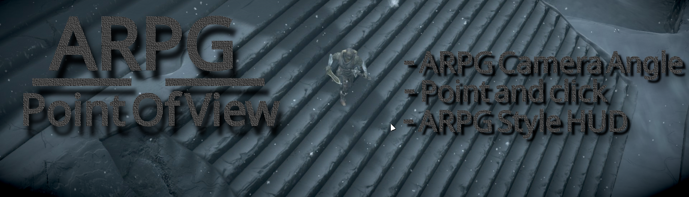
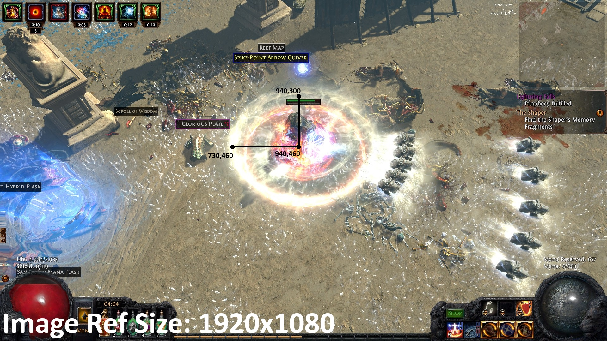

# ARPG POV (ARPG Point Of View)

**Play Skyrim like Path of Exile.** One SKSE plugin:

- **ARPG camera angle:** a locked top-down camera, with presets from Path of Exile, Diablo and more
- **Point and click:** click to move, attack, loot, talk and use doors
- **ARPG style HUD:** life and mana globes

There's also an interior cutaway, outlines, and item labels with a loot filter. Made for Vortex and tested on Skyrim SE **1.7.104**.

> ### Get the full modpack: [ARPG POV Nexus Collection](https://www.nexusmods.com/games/skyrimspecialedition/collections/5qdega)
> It's a Diablo-style Skyrim in one click in Vortex: ARPG POV, its requirements, combat, skills, DiabloRim loot and Alternate Start. **[Open the collection](https://www.nexusmods.com/games/skyrimspecialedition/collections/5qdega)**

> ### Everything is customizable
> Press **F1** in game, then go to **ARPG POV**. Every feature can be switched on or off and tuned there, live. The defaults are my picks for the collection. Don't want the globes? Turn them off in F1 → HUD. Prefer WASD? Press F7.

**[Nexus page](https://www.nexusmods.com/skyrimspecialedition/mods/198647)** · **[Installation Guide (PDF)](docs/ARPG-POV-Installation-Guide.pdf)** · **Video guide: (In Progress)**

## Install

### 📄 [Open the Installation Guide (PDF)](docs/ARPG-POV-Installation-Guide.pdf)
It has the full step-by-step guide, the exact TDM settings, a first-launch checklist and fixes.

**Quick version** (made for Vortex, Skyrim SE 1.7.104):
1. **Download Skyrim, mods and dependencies.** Get [SKSE](https://skse.silverlock.org/), [Address Library](https://www.nexusmods.com/skyrimspecialedition/mods/32444), [SKSE Menu Framework](https://www.nexusmods.com/skyrimspecialedition/mods/120352), [True Directional Movement](https://www.nexusmods.com/skyrimspecialedition/mods/51614), [Pandora Behaviour Engine](https://www.nexusmods.com/skyrimspecialedition/mods/133232) and ARPG POV, or install [the collection](https://www.nexusmods.com/games/skyrimspecialedition/collections/5qdega).
2. **Launch Pandora's .exe through Vortex** and run it for TDM.
3. **Configure TDM first, or the camera won't work properly.** Drop my [TrueDirectionalMovement.ini](TrueDirectionalMovement.ini) into `<game folder>\Data\MCM\Settings\`, then launch with SKSE and press **F1**.

If you use [3PCO - 3rd Person Camera Overhaul](https://www.nexusmods.com/skyrimspecialedition/mods/18515), turn it off. ARPG POV handles the camera itself.

**My settings files:** everything is in this repo.
- [TrueDirectionalMovement.ini](TrueDirectionalMovement.ini) goes in `<game folder>\Data\MCM\Settings\`.
- [GridInventory_ui.ini](GridInventory_ui.ini) goes in `<game folder>\Data\SKSE\Plugins\`. It sets DiabloRim's inventory to 10×40, the most it allows (`!basegrid = 10, 40`). With ARPG POV's carry weight that's 10×45. It also makes the game keep running while the inventory is open (`!nopause = 1`), turns the quick wheel off, and applies my skin and UI scale. Your own window positions are kept.

## The collection

| | Mods |
|---|---|
| **Required** | SKSE, Address Library, SKSE Menu Framework, True Directional Movement, [Pandora Behaviour Engine](https://www.nexusmods.com/skyrimspecialedition/mods/133232) |
| **Base** | ARPG POV, [SkyUI](https://www.nexusmods.com/skyrimspecialedition/mods/12604), [MCM Helper](https://www.nexusmods.com/skyrimspecialedition/mods/53000), [Alternate Start - Live Another Life](https://www.nexusmods.com/skyrimspecialedition/mods/272) |
| **Camera** | [Some Collision Camera](https://www.nexusmods.com/skyrimspecialedition/mods/57864), [Motion Sensitive Fix](https://www.nexusmods.com/skyrimspecialedition/mods/35833) |
| **Combat** | [Precision](https://www.nexusmods.com/skyrimspecialedition/mods/72347) |
| **Skills and spells** | [Ordinator](https://www.nexusmods.com/skyrimspecialedition/mods/1137), [Apocalypse](https://www.nexusmods.com/skyrimspecialedition/mods/1090), [Summermyst](https://www.nexusmods.com/skyrimspecialedition/mods/6285) |
| **Loot** | [DiabloRim](https://www.nexusmods.com/skyrimspecialedition/mods/190634) (needs Grid Inventory and [EPW4NPCs](https://www.nexusmods.com/skyrimspecialedition/mods/37607), which Nexus lists when you download it; install Grid Inventory first and let DiabloRim overwrite it), [Socketing](https://www.nexusmods.com/skyrimspecialedition/mods/195740) |
| **Crash reports** | [Crash Logger SSE](https://www.nexusmods.com/skyrimspecialedition/mods/59818) |

## F1 menu
| Page | Changes |
|---|---|
| Camera | Preset, pitch, yaw lock, distance, FOV, offsets, TDM behaviour |
| Cutaway | On/off, Default or Automatic style, cut height |
| Controls | Point and click, cursor, click behaviour, hold to attack, auto-attack, aim at the cursor |
| Outlines | Who glows, ground circles, glow, distances |
| Labels and Loot | Labels and the loot filter |
| HUD | Globes, vanilla bars, size, numbers |
| Player | Carry weight and speed |

**Camera presets:** Default (pitch 30, distance 1290, FOV 50), Path of Exile 2 (same as Default), Path of Exile, Diablo II, Diablo III, Diablo IV, Last Epoch, Grim Dawn, Torchlight II, Skyrim ARPG and Custom. Only the Diablo II, Path of Exile and Path of Exile 2 pitches were measured; the rest are estimates.

Click **Save to INI** to keep your changes. The INI is `Data/SKSE/Plugins/ARPGPOV.ini`, and **F8** reloads it.

## Controls
| Input | Does |
|---|---|
| Left click | Move (hold to follow), attack, pick up, doors, talk, loot, seats and levers |
| Shift + left click | Attack in place |
| Hold attack (+ Left Alt) | Keep attacking (power attack) |
| Middle mouse | Use things without moving or attacking |
| WASD + TDM lock-on | Still works |
| F1 / F7 / F8 | Settings / point and click on-off / reload INI |
| F9 / F10 | Cutaway style / camera lock on-off |
| Page Up / Page Down | Camera pitch |
| F2 | Turn 90° (with Lock yaw on). Insert before 1.6.1; an INI you kept still has Insert |

Cursor: a red sword means attack, a gold bag means loot, an exclamation mark means talk (green) or use (white), and an arrow means move. A small ring on the ground marks where a click is sending you.

## Troubleshooting
| Problem | Fix |
|---|---|
| Nothing changes | Launch through `skse64_loader.exe`. Check that SKSE and Address Library match 1.7.104. |
| No cursor or F1 menu | Install SKSE Menu Framework |
| Camera fights you or swings behind you | Turn off 3PCO - 3rd Person Camera Overhaul and recheck TDM (see the PDF) |
| TDM settings didn't apply | The file must be at `Data\MCM\Settings\TrueDirectionalMovement.ini`, copied with Skyrim closed |
| Left click does nothing | Bind it to an attack, then press F7 |
| Clicks land on chairs | F1 → Controls: untick furniture and activators |
| Low FPS in crowds | F1 → Outlines: lower the distances |
| Crash indoors | F9 for the Default style, then send a crash log |
| Inventory is only 10×8 / "Out of space" | Use my [GridInventory_ui.ini](GridInventory_ui.ini), or set `!basegrid = 10, 40` in `Data\SKSE\Plugins\GridInventory_ui.ini` with Skyrim closed |

**Crash logs:** set `[Debug] Cutaway = 1` and `PointClick = 1`, then reproduce the crash. Send the newest `crash-<date>.log` (from [Crash Logger SSE](https://www.nexusmods.com/skyrimspecialedition/mods/59818)) and `ARPGPOV.log` from `Documents\My Games\Skyrim Special Edition\SKSE\` as a [GitHub issue](https://github.com/nannernick/ARPG-POV-Skyrim-mod/issues), on the Nexus Bugs tab, on Discord (**nannernick**) or on Twitter (**@nannernickCS**).

**Uninstall:** speed and carry weight are stored in your save. Reset them in F1 → Player (**Apply now**), save, then remove the mod.

## Reference

**Cutaway:** indoors, the GPU removes everything above a cut line, so walls end cleanly and roofs vanish. *Default* is a flat cut. *Automatic* (experimental) slopes up and rises when nothing blocks your view. The cut stays at one height per floor. The idea comes from machinegod's *Skyrim Camera Disocclusion System*, built separately here.

**Outlines:** true model outlines. Enemies are red, followers blue, you white, NPCs green, loot gold and quest items bright green. A character is outlined whole or not at all. The renderer is from AmazingBuff's [Highlight Lootable Corpses](https://github.com/AmazingBuff/HighlightLootableCorpses). It's untested with ENB and Community Shaders.

**Loot filter:** gear, potions, scrolls, keys, soul gems, gold, gems and ore always show. Food, ingredients, books and clutter each have a switch. `MinValue` hides cheap items.

INI defaults (the values in the shipped `ARPGPOV.ini`):

<b>[Camera]</b> camera locker

| Setting | Default | |
|---|---|---|
| `Enabled` | 1 | Lock on at game start |
| `LockPitch` / `Pitch` | 1 / 30 | Lock the angle, degrees looking down |
| `LockYaw` / `Yaw` | 0 / 45 | Lock the compass direction (0 = north) |
| `Preset` | Default | Camera look: Default (same as Path of Exile 2), Custom, Skyrim ARPG, Diablo II, Path of Exile, Path of Exile 2, Diablo III, Diablo IV, Last Epoch, Grim Dawn, Torchlight II. Sets pitch, FOV and distance; only the pitch of Diablo II, Path of Exile and Path of Exile 2 was measured, the rest are estimates |
| `Manage` / `Distance` / `Fov` / `OffsetX` / `OffsetZ` / `WheelZoom` | 1 / 1290 / 50 / 0 / 0 / 0 | Camera distance, field of view, shoulder offsets, mouse-wheel zoom (replaces 3PCO - 3rd Person Camera Overhaul) |
| `FixInteriorRooms` | 1 | Draw your room when the camera is above the ceiling |
| `PauseOnTargetLock` | 0 | Let TDM hold the camera while locked on |
| `KeepHeading` | 1 | Keep the camera's compass heading when TDM turns it (target lock, its camera reset, its auto-adjust), while the mouse isn't turning the camera |
| `PitchMode` / `InvertPitch` | 0 / 0 | Leave at 0 unless the camera looks up |
| `ToggleKey` | 0x44 (F10) | Camera on/off |
| `PitchUpKey` / `PitchDownKey` / `PitchStep` | 0xC9 (PgUp) / 0xD1 (PgDn) / 5 | Change pitch in game |
| `YawStepKey` | 0x3C (F2) | Turn the camera 90 degrees per press. Only with `LockYaw = 1`. Was 0xD2 (Insert) before 1.6.1 |
| `ReloadKey` | 0x42 (F8) | Reload the INI |
| `DebugLog` | 0 | Log camera values once a second |

<b>[Player]</b> and <b>[GameSettings]</b>

| Setting | Default | |
|---|---|---|
| `CarryWeight` | 10000 | Applied on every load (0 = leave alone) |
| `SpeedMult` | 130 | Movement speed, 100 = vanilla (0 = leave alone) |
| `[GameSettings]` | `fMoveEncumEffect = 0`, `fMoveEncumEffectNoWeapon = 0` | Any engine setting (the names `setgs` uses), applied every launch |

<b>[Cutaway]</b> and <b>[Cut]</b> camera splitter

| Setting | Default | |
|---|---|---|
| `Enabled` | 1 | Splitter on/off |
| `InteriorOnly` | 1 | Only split indoors |
| `Height` | 200 | Cut height above the floor (a human is ~128) |
| `Slope` | 0.3 | Automatic style only: the cut is at `Height` at the bottom of the screen and rises this fast away from the camera. the Default style is always flat |
| `AutoLift` | 0 | Starting style: 0 = Default, 1 = Automatic (experimental) |
| `StyleKey` | 0x43 (F9) | Switch style |
| `ClearDelay` / `LiftMax` | 0.75 / 1600 | Automatic: seconds of clear view before it lifts, how far it lifts |
| `ReanchorDistance` / `ReanchorDelay` | 75 / 0.5 | How far and how long you must stand on a new floor before the cut moves |
| `HeightSmoothing` / `MaxHeightSpeed` | 0.2 / 1600 | How gently height changes ease in |
| `AllGeometry` | 1 | Leave on (keeps props and characters visible) |

<b>[Cells]</b>, <b>[Background]</b>, <b>[Debug]</b>

| Setting | Default | |
|---|---|---|
| `[Cells] EditorID = 260` or `= off` | none | Per-interior cut height or off. Editor IDs show in the log. |
| `BlackFog` | 1 | Black interior fog while inside |
| `HideSky` | 1 | Hide the sky dome while inside |
| `[Debug] Cutaway` / `PointClick` | 0 / 0 | Write diagnostics to `ARPGPOV.log` |

<b>[PointClick]</b>, <b>[Cursor]</b>, <b>[Move]</b>, <b>[Pickup]</b>, <b>[Labels]</b>, <b>[Outlines]</b>

| Setting | Default | |
|---|---|---|
| `[PointClick] Enabled` / `ToggleKey` | 1 / 0x41 (F7) | On at start, on/off key |
| `[PointClick] ClickMarker` | 1 | A small ring on the ground where a click is sending you. It fades when you arrive or cancel |
| `[Cursor] Sensitivity` / `Size` | 1 / 1 | Cursor speed and size |
| `[Cursor] Ring` | 1 | Ring behind the sword, bag and exclamation mark, in the symbol's colour |
| `[Cursor] InMenus` | 1 | Use this cursor in the inventory, containers, barter and other menus, starting where it was |
| `[Cursor] BlockMouseLook` / `RotateKey` | 1 / 0 | Mouse moves the cursor, hold a key to rotate the camera |
| `[Move] Button` / `HoldToMove` | 0 (left) / 1 | Move button, follow the cursor while held |
| `[Move] ArriveRadius` / `MaxDistance` | 40 / 3000 | Stop distance, furthest one click sends you |
| `[Move] ClickEnemies` / `ClickInteract` / `AttackInPlaceKey` | 1 / 1 / 0x2A (Shift) | Click enemies to attack, click things to use them, attack-in-place key |
| `[Move] Mode` | 0 | 0 = auto, 1 = TDM, 2 = turn the player (no TDM) |
| `[Pickup] Button` / `Range` | 2 (middle) / 150 | Extra use button, reach before you walk |
| `[Pickup] Containers` / `Actors` / `Activators` | 1 / 1 / 1 | Chests and barrels / corpses and NPCs / named furniture and activators (seats, levers) can be clicked |
| `[Labels] Mode` / `Key` | 1 / 0x38 (Alt) | 0 = hovered only, 1 = always, 2 = while the key is held |
| `[Labels] Radius` / `MaxHeightDiff` | 2000 / 300 | How far away, and how far above/below, items get labels |
| `[Labels] Max` / `Scale` / `MinValue` | 100 / 0.6 / 15 | Label cap, text size, minimum value |
| `[Labels] StackCount` | 5 | Stacks this big or bigger read `200x Gold`; smaller ones show the name only |
| `[Labels] ShowFood` / `ShowIngredients` / `ShowBooks` / `ShowClutter` | 0 / 0 / 0 / 0 | Loot filter switches |
| `[Globes] Enabled` / `HideVanillaBars` / `Size` / `Numbers` / `Animate` | 1 / 1 / 1 / 1 / 1 | Life and mana globes, hide the game's bars, globe size, numbers, moving liquid |
| `[Outlines] Enabled` / `Enemies` / `NPCs` / `Player` / `Loot` | 1 / 1 / 0 / 1 / 0 | Outlines on, and per group (hovered things always glow). `Loot` = dropped items, containers and corpses (`Items` before 1.6) |
| `[Outlines] Followers` / `FollowerColor` | 1 / 0x50A0FF | Followers' own switch and colour (0xRRGGBB) |
| `[Outlines] QuestItems` / `QuestItemColor` | 1 / 0x39FF14 | Quest items lying in the world always get a label and an outline in this colour, with `Loot = 0` too and whatever the loot filter says. `ItemRadius` and the height limits still apply |
| `[Outlines] Circles` / `CircleRadius` | 0 / 45 | Ground circles under enemies, NPCs and followers, and their size |
| `[Combat] HoldToAttack` / `PowerAttackKey` | 1 / 0x38 | Holding attack keeps swinging; with the key (Left Alt) held it's a power attack |
| `[Combat] AutoAttack` | 0 | While locked on, one press of attack starts auto-attack and the next stops it |
| `[Combat] AimAtCursor` | 1 | Spells and bows aim at the cursor or the hovered enemy |
| `[Labels] MaxBelow` | 60 | Items lower than this under your feet get no label and can't be clicked |
| `[Outlines] Thickness` / `Opacity` / `Brightness` / `Fade` | 5 / 0.9 / 0.9 / 1 | Glow size (1-8), glow strength, colour brightness (lower = darker), fainter with distance |
| `[Outlines] Radius` / `ItemRadius` | 1500 / 700 | How far away actors / items are outlined |
| `[Outlines] MaxParts` | 256 | Most model parts outlined in one frame (64-1024). Armoured crowds can reach it; higher outlines more of them and costs frames |
| `[Outlines] Partial` | 0 | 0 = a character whose model could only be read in part gets no outline unless the cursor is on it. 1 = outline whatever was read |
| `[Outlines] MaxAbove` | 120 | Items, containers and corpses higher than this above your feet get no outline or label |
| `[Outlines] MaxBelow` | 150 | Enemies, NPCs and followers lower than this under your feet get no outline or circle unless the cursor is on them |
| `[Outlines] BehindPlayer` | 1 | Things behind your character don't glow over it |

<b>Angle math</b>

| Game | Pitch |
|---|---|
| Diablo II | 30 (2:1 floor tiles: arcsin(1 ÷ 2) = 30°) |
| Path of Exile | 50 (ring 210 × 160 px at 1080p: arcsin(160 ÷ 210) = 49.6°) |
| Path of Exile 2 | 30 (ring ~700 × 350 px: arcsin(350 ÷ 700) = 30°) |
| Diablo IV | not measured yet |

**Pitch = arcsin(height ÷ width)**

To measure any game, screenshot a circle on the ground (an AoE ring) near the center of the screen, then measure its width and height in pixels. ARPGs use a narrow lens from far away, so also lower the FOV (~40–55) and raise the distance (F1 → Camera).

## Upcoming features
Planned, not in this version:
- **Right mouse button, BG3 style:** drag to rotate the camera, press on an enemy for the left-hand action.
- **Custom cursor image** and more cursor options.
- **Better auto-attack:** click an enemy once and keep attacking it, with bows, staves and spells too.
- **Camera only in combat**, with a battle transition.
- **Pathfinding** for click-to-move.
- **An MCM settings page.**

## Known issues
- **Interiors can crash** (seen in a cave, and going downstairs with the cutaway on). The Automatic cutaway style is suspected. A Crash Logger SSE log is needed to find it.
- **Your own outline can flip in front of / behind your character** while moving indoors.
- **Outlines could show only fragments of a character in a crowd** (a helmet, boots, bracers) in 1.6.0. From 1.6.1 a character is outlined whole or not at all, and its model is read again while it is still loading. Needs testing. If a kind of enemy now never gets an outline, set `[Outlines] Partial = 1` and send `ARPGPOV.log`.
- **Quest items are found by the game's quest-object flag.** Items a quest doesn't flag (many dragon claws on their pedestals) keep their normal colour.
- **The 90° yaw key is F2 from 1.6.1** (it was Insert). An INI you kept still has `YawStepKey = 0xd2`.
- **The pitch keys changed code in 1.6** to the real Page Up / Page Down (0xC9 / 0xD1). Before, the INI held 0x49 / 0x51, which are Numpad 9 / Numpad 3. An INI you kept still has the old codes.
- **Cobwebs and other ceiling-level props** can be missing under the cut.
- **Spells can still hit the ground** if True Directional Movement steers the projectile.
- **Path of Exile 2 is the default camera from 1.6.** The cut heights were tuned at the old distance (600) and may need retuning at 1290.
- **Furniture and activators are clickable from 1.6.** In a room full of chairs a click meant for the floor can land on one; `[Pickup] Activators = 0` switches it off.

## Credits
- **AmazingBuff**: the outline renderer (`src/render`, `src/base`), from [Highlight Lootable Corpses](https://github.com/AmazingBuff/HighlightLootableCorpses), GPL-3.0.
- **machinegod**: the cutaway idea, from *Skyrim Camera Disocclusion System*. The cutaway here is a separate implementation.
- **Shizof**: [3PCO - 3rd Person Camera Overhaul](https://www.nexusmods.com/skyrimspecialedition/mods/18515). ARPG POV's camera distance, FOV and offset handling rebuilds what 3PCO does, and 3PCO was used with this mod until it was built in.
- CommonLibSSE-NG contributors, the SKSE team, meh321 (Address Library), Thiago099 (SKSE Menu Framework), Ershin (True Directional Movement).

## Contact
Twitter **@nannernickCS** · Discord **nannernick** · [Issues](https://github.com/nannernick/ARPG-POV-Skyrim-mod/issues)

## License
GPL-3.0-or-later, as the plugin links CommonLibSSE-NG and includes GPL-3.0 code from Highlight Lootable Corpses.
